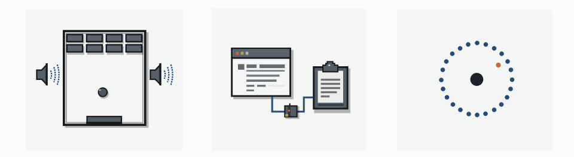
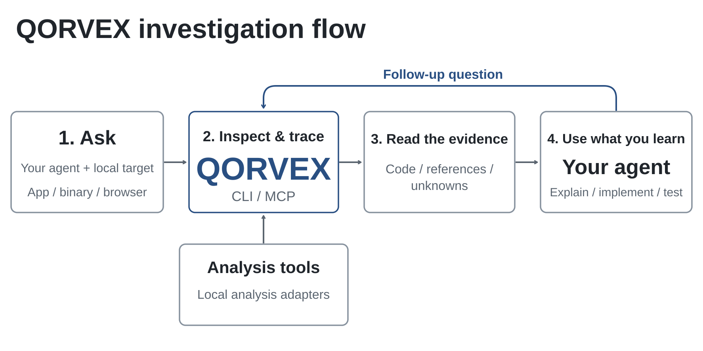

<div align="center">

[English](../../README.md) · [简体中文](README_zh.md) · [繁體中文](README_zh-TW.md) · [日本語](README_ja.md) · [한국어](README_ko.md) · [Türkçe](README_tr.md) · [Русский](README_ru.md) · [Tiếng Việt](README_vi.md) · [ไทย](README_th.md) · [Deutsch](README_de.md) · [Español](README_es.md) · [Français](README_fr.md) · [Українська](README_uk.md) · [Polski](README_pl.md) · [Português (Brasil)](README_pt-BR.md) · **العربية** · [فارسی](README_fa.md) · [Bahasa Indonesia](README_id.md) · [Italiano](README_it.md)
· [Ελληνικά](README_el.md) · [മലയാളം](README_ml.md) · [Roman Urdu](README_ur-Latn.md) · [Română](README_ro.md) · [Български](README_bg.md)

# QORVEX: هندسة عكسية لأي شيء

### خادم MCP واحد للهندسة العكسية للملفات الثنائية والتطبيقات والسلوك أثناء التشغيل.

**وجدت ميزة تعجبك؟ افهم طريقة عملها حتى مستوى الشيفرة الثنائية.**

[](https://github.com/TOSTES-LAB/andre_009988/stargazers)
[](https://www.npmjs.com/package/qorvex-agents)
[](../../LICENSE)
[](https://discord.gg/GkcryMnJDM)
[](https://x.com/reatools)
[](../getting-started/installation.md)
[](https://skills.sh/TOSTES-LAB/andre_009988/reverse-engineer-anything)

**[الموقع](https://qorvex.tools/ar/) · [الأدلة](https://qorvex.tools/ar/guides/) · [دراسات الحالة](https://qorvex.tools/ar/showcase/)**

<a href="https://discord.com/invite/GkcryMnJDM"></a>

[البدء السريع](#البدء-السريع) · [دراسات الحالة](#دراسات-الحالة) · [كيف يعمل QORVEX](#كيف-يعمل-qorvex) · [ما الذي يمكنك تحليله](#ما-الذي-يمكنك-تحليله) · [إنشاء بيئات التعلم المعزز](#build-rl-environments) · [الأسئلة الشائعة](#الأسئلة-الشائعة) · [التوثيق](#التوثيق)

<code>npx qorvex-agents setup</code>

</div>

> [!IMPORTANT]
> المصادر الرسمية لـ QORVEX: [TOSTES-LAB/andre_009988](https://github.com/TOSTES-LAB/andre_009988), [qorvex.tools](https://qorvex.tools/), [qorvex-agents](https://www.npmjs.com/package/qorvex-agents) (npm).
> استخدم روابط التثبيت والإصدارات المنشورة في هذه المصادر الرسمية. تشابه اسم المستودع أو نسخ ملف README لا يثبت أن التنزيل رسمي.

<div align="center">

<br />


<br /><br />

<table aria-label="مجتمع QORVEX">
<tr>
<td align="center" width="360">
  <a href="https://discord.gg/GkcryMnJDM">
    <br />
    <strong>انضم إلى مجتمع الهندسة العكسية</strong>
  </a><br />
  <sub>Discord · أسئلة وأجوبة · مشاركة النتائج</sub>
</td>
</tr>
</table>

<br />

</div>

---

هل وجدت في تطبيق ميزة تريد إضافتها إلى منتجك؟ اطلب من وكيلك استقصاءها باستخدام QORVEX. يستطيع فحص التطبيق من دون شيفرته المصدرية، وشرح طريقة عمل الميزة وعرض الأدلة، ثم بناء نسخة تناسب مشروعك.

يربط QORVEX وكيلك بأدوات لفحص الملفات الثنائية للشيفرة الأصلية، وتطبيقات JavaScript وElectron، وتجميعات .NET، والمواقع. يمكنك أيضًا استخدام الأدوات نفسها من الطرفية. يجري التحليل محليًا، وتتضمن النتائج الأدلة والقيود التي تستند إليها كل خلاصة.

يسجّل الإعداد QORVEX لدى وكيلك ويثبّت تعليمات العمل المطابقة. يمكن للتحليل الأصلي استخدام Hopper أو Ghidra أو IDA أو Kuna المثبّت مسبقًا؛ ويمكن تثبيت Hopper بعد موافقتك. لا يحتاج التحليل الثابت لـ JavaScript إلى محرك تحليل أصلي.

## البدء السريع

**[البدء السريع · qorvex.tools](https://qorvex.tools/ar/get-started/)**

### إعداد وكيلك (MCP)

بعد تثبيت [Node.js وnpm](../reference/supported-targets.md)، شغّل الأمر التالي من مجلد موثوق خارج المشروع الذي تريد تحليله.

```bash
npx qorvex-agents setup
```

اختر الوكلاء، وراجع التغييرات المقترحة، ثم وافق عليها. يضيف الإعداد خادم MCP الخاص بـ QORVEX وتعليمات سير العمل المطابقة، مع الاحتفاظ بنسخ احتياطية من الإعدادات الموجودة. أعد تشغيل وكيلك بعد ذلك.

[التثبيت والإعداد](../getting-started/installation.md)

اطلب من وكيلك:

```text
استقصِ طريقة عمل البحث في تطبيق Notes، واعرض الأدلة، ثم ابنِ ميزة مشابهة لمشروعي.
```

استبدل Notes بالتطبيق المستهدف وحدّد الميزة التي تريد فهمها.

### استخدام الطرفية (CLI)

افحص مجلد تطبيق JavaScript/Electron بعد فك حزمه، أو ملف ASAR:

```bash
npx -y qorvex-agents@latest analyze-javascript-application /absolute/path/to/app --json
```

تتضمن النتيجة الوحدات وعمليات الاستيراد وحدود Electron والأدلة المتعلقة بها. استبدل المسار بمسار هدفك، مثل `"D:/apps/example"` على Windows.

لتثبيت أمر `qorvex` للاستخدام المعتاد:

```bash
npm install --global qorvex-agents
qorvex --help
```

لتحليل الشيفرة الأصلية، هيّئ موفّرًا أولًا. راجع [دليل CLI وEvidence](../getting-started/cli.md) لأوامر تحليل الشيفرة الأصلية، واختيار الموفّر، واللقطات، والاستخدام في السكربتات.

[متطلبات Linux](../getting-started/installation.md#linux-owned-process-prerequisite)

### تحديث QORVEX

لواجهة CLI المثبّتة عبر `npm install --global` / `bun add --global`:

```bash
qorvex update
```

إذا كنت تستخدم `npx`، فحدّث إعداد وكيلك بالأمر التالي:

```bash
npx qorvex-agents@latest setup
```

[التحديث وإلغاء التثبيت](../getting-started/installation.md#diagnose-update-and-remove)

## دراسات الحالة

<a href="https://qorvex.tools/ar/showcase/">
  <picture>
    <source media="(prefers-color-scheme: dark)" srcset="../assets/qorvex-showcases-dark.svg" />
    
  </picture>
</a>

<table>
<tbody>
<tr><td>
<h3>DX-Ball: إعادة بناء حساب توزيع الصوت بين القناتين</h3>
<p>تتبّع استدعاء صوت إلى الدالة المساعدة التي تحوّل الموضع إلى توزيع بين القناتين، وافحص التعليمات، وحوّل الشيفرة شبه البرمجية غير المكتملة إلى C. تجتاز إعادة البناء 3,205 حالات اختبار على x86 الأصلي، وتعيد إنتاج جميع بايتات الدالة المترجمة البالغ عددها 63 بايتًا.</p>
<p><a href="https://qorvex.tools/ar/showcase/dx-ball/">اقرأ دراسة الحالة</a> ·
<a href="https://github.com/N0zoM1z0/dx-ball">مستودع إعادة البناء</a></p>
</td></tr>
<tr><td>
<h3>Notion: تتبّع جسر الحافظة في Electron</h3>
<p>اعثر على API الحافظة في عملية العرض، وتتبّعه عبر preload وIPC إلى العملية الرئيسية، وافحص صيغة الحافظة ذات التنسيق الغني.</p>
<p><a href="https://qorvex.tools/ar/showcase/notion/">اقرأ دراسة الحالة</a></p>
</td></tr>
<tr><td>
<h3>TH04: استعادة حساب حلقة المقذوفات في DOS</h3>
<p>افحص تعليمات اللعبة الأصلية على PC-98 ذات 16 بت، واستعد حساب الزوايا الثابتة والموجّهة نحو الهدف، وقارن شيفرة C++ المعاد بناؤها بمخرجات المترجم المستخدم آنذاك.</p>
<p><a href="https://qorvex.tools/ar/showcase/th04/">اقرأ دراسة الحالة</a> ·
<a href="https://github.com/N0zoM1z0/th04">مستودع إعادة البناء</a></p>
</td></tr>
</tbody>
</table>

إذا استخدمت QORVEX لفحص هدف مثير للاهتمام، فنود الاطلاع عليه. شارك حالتك في [issue](https://github.com/TOSTES-LAB/andre_009988/issues) أو [pull request](https://github.com/TOSTES-LAB/andre_009988/pulls)، مع ذكر الهدف، وسؤالك، وكيف ساعدك QORVEX، وما توصلت إليه.

## كيف يعمل QORVEX

يستدعي وكيلك QORVEX عبر MCP لفحص الهدف وتتبع الشيفرة ذات الصلة. يعيد QORVEX النتائج مع أدلتها. يستخدمها الوكيل لطرح أسئلة متابعة، أو شرح السلوك، أو كتابة تنفيذ واختباره. تستخدم أوامر CLI سير العمل نفسه.



[افتح الشكل بحجمه الكامل](../../website/public/assets/figures/qorvex-investigation-flow.svg).

<a id="current-status"></a>

## ما الذي يمكنك تحليله

الملفات الثنائية للشيفرة الأصلية · JavaScript / Electron · المواقع · تجميعات .NET · حزم Android APK · البرامج الثابتة · سلوك العمليات

[التنسيقات المدعومة والمتطلبات](../reference/supported-targets.md)

<a id="choosing-a-deep-analysis-provider"></a>

[اختيار مزوّد التحليل](../reference/supported-targets.md#choosing-a-deep-analysis-provider)

<a id="build-rl-environments"></a>

## إنشاء بيئات التعلم المعزز

أنشئ بيئة محلية من جلسة ويب مسجّلة أو تطبيق سطح مكتب يعمل على Linux ليتدرّب الوكيل على مهمة ويتحقق من نتيجتها.

[إنشاء بيئات التعلم المعزز](https://qorvex.tools/guides/rl-environments/)

## الأسئلة الشائعة

<details>
<summary><strong>أي وكلاء يمكنهم استخدام QORVEX؟</strong></summary>

أي وكيل يدعم خوادم MCP المحلية. يهيّئ الإعداد [الوكلاء المدعومين](../getting-started/installation.md#supported-agents)؛ ويمكن للعملاء الآخرين استخدام [تسجيل MCP يدويًا](../getting-started/installation.md#mcp-registry).

</details>

<details>
<summary><strong>هل أحتاج إلى Hopper أو Ghidra أو IDA أو Kuna؟</strong></summary>

يستخدم تحليل الشيفرة الأصلية المتعمق أحدها. يعمل الفحص الثابت لـ JavaScript و.NET دون محرك لتحليل الشيفرة الأصلية. يستطيع الإعداد تثبيت Hopper بعد الموافقة؛ أما Ghidra وIDA وKuna فتستخدم تثبيتاتك الموجودة. راجع [إعداد الموفّرين](../getting-started/installation.md#hopper).

</details>

<details>
<summary><strong>هل أحتاج إلى تشغيل Hopper أولًا؟</strong></summary>

يشغّل QORVEX برنامج Hopper عندما تحتاج العملية إليه. على macOS، قد تظهر عند التشغيل الأول نافذة تطلب اختيار وضع العرض التجريبي أو تفعيل الترخيص. راجع [تشغيل Hopper واستكشاف الأخطاء](../getting-started/installation.md#launcher-paths-and-troubleshooting).

</details>

<details>
<summary><strong>ماذا يفعل تثبيت المهارة من skills.sh؟</strong></summary>

توفّر المهارة تعليمات الاستقصاء لوكيلك. استخدم `npx qorvex-agents setup` لتسجيل خادم MCP الخاص بـ QORVEX وتثبيت التعليمات المطابقة، ثم أعد تشغيل وكيلك. راجع [تثبيت المهارة وحدها](../getting-started/installation.md#skill-only-installation).

</details>

<details>
<summary><strong>ما الشيفرة التي يعيدها QORVEX؟</strong></summary>

يعيد تحليل الشيفرة الأصلية شيفرة شبه برمجية وتعليمات تجميع. يستعيد تحليل JavaScript/Electron الوحدات والعلاقات بينها. يستخدم وكيلك هذه النتائج لكتابة تنفيذ واختباره؛ وتقدّم [دراسات الحالة](#دراسات-الحالة) أمثلة عملية.

</details>

<details>
<summary><strong>هل يرفع QORVEX تطبيقي؟</strong></summary>

يحلّل QORVEX الأهداف محليًا. يتلقى وكيلك نتائج الأدوات، ولموفّر النموذج الذي يستخدمه سياسة بيانات خاصة به.

</details>

<details>
<summary><strong>ماذا أفعل إذا واجهت خطأ؟</strong></summary>

حدّث أولًا؛ فقد يكون إصدار حديث قد أصلح المشكلة بالفعل.

لواجهة CLI المثبّتة عبر npm:

```bash
qorvex update
```

لإعداد الوكيل عبر `npx`:

```bash
npx qorvex-agents@latest setup
```

إذا كنت تستخدم وكيلًا، فأكمل [تحديث الإعداد](#تحديث-qorvex) وأعد تشغيله. أعد محاولة المهمة نفسها. إذا استمرت المشكلة، [افتح issue](https://github.com/TOSTES-LAB/andre_009988/issues) يتضمن إصدار QORVEX، ونوع الهدف، وخطوات إعادة الإنتاج، ومخرجات الخطأ.

</details>

## التوثيق

ابدأ بـ [الأدلة العملية](https://qorvex.tools/ar/guides/) على الموقع. للخيارات الدقيقة والمتطلبات وعقود النتائج:

- [التثبيت والإعداد](../getting-started/installation.md): تسجيل الوكلاء، وتهيئة الموفّرين، والتحديثات، وإلغاء التثبيت.
- [الجاهزية واستكشاف الأخطاء](../getting-started/installation.md#check-readiness-for-your-task): تشخيص وكيل أو محرك تحليل محدد.
- [CLI وEvidence](../getting-started/cli.md): الأوامر، واختيار الموفّر، واللقطات، والاستيراد/التصدير، وحالات الخروج.
- [عقود MCP](../reference/mcp-contracts.md) و[تعليمات الوكلاء](../getting-started/mcp-prompts.md): نتائج الأدوات، والجلسات، والاستقصاءات الموجّهة.
- [كتالوج الأدوات](../reference/mcp-contracts.md#generated-catalog): قائمة الأدوات والموفّرين وأوامر CLI المولّدة أثناء البناء.

أبلغ عن الثغرات وفق [SECURITY.md](../../SECURITY.md).

## المجتمع والدعم

- **Discord** — اطرح أسئلتك وشارك أبحاثك مع مجتمعنا الذي يضم أكثر من ٥٠ ألفًا من الشغوفين بالهندسة العكسية وبناء المشاريع! [](https://discord.gg/GkcryMnJDM)
- **Twitter / X** — تابع [@reatools](https://x.com/reatools) للاطلاع على التحديثات والإعلانات.
- **الملاحظات والأفكار** — هل تريد ميزة جديدة أو دعم تنسيق ملفات؟ أخبرنا عبر [GitHub](https://github.com/TOSTES-LAB/andre_009988/issues) أو [Discord](https://discord.gg/GkcryMnJDM).

## سجل النجوم

🎉 **400,000 نجمة على GitHub — شكرًا لكم!**

شكرًا لكل من يستخدم QORVEX، ويبلّغ عن الأخطاء، ويقترح ميزات، ويختبر إصدارات البناء، ويساهم بالإصلاحات.

<a href="https://qorvex.tools/ar/contributors/">
  
</a>

<a href="https://www.star-history.com/?repos=TOSTES-LAB%2Frea&amp;type=date">
  <picture>
    <source media="(prefers-color-scheme: dark)" srcset="https://api.star-history.com/chart?repos=TOSTES-LAB/andre_009988&amp;type=date&amp;theme=dark&amp;legend=top-left" />
    <source media="(prefers-color-scheme: light)" srcset="https://api.star-history.com/chart?repos=TOSTES-LAB/andre_009988&amp;type=date" />
    
  </picture>
</a>

## المساهمة

نرحّب بمساعدتك في تطوير QORVEX! [افتح issue](https://github.com/TOSTES-LAB/andre_009988/issues) للإبلاغ عن خطأ أو اقتراح ميزة، أو [أرسل pull request](https://github.com/TOSTES-LAB/andre_009988/pulls) لتحسين الشيفرة أو التوثيق.

راجع [CONTRIBUTING.md](../../CONTRIBUTING.md) لإعداد بيئة التطوير والفحوص، و[دليل الاختبار](../development/testing.md) لمسارات التحقق.

## إخلاء المسؤولية

راجع [DISCLAIMER.md](../../DISCLAIMER.md) للحصول على إرشادات الاستخدام المسؤول.

QORVEX مخصص للبحث والتعليم والتشغيل البيني وحفظ البرمجيات بشكل قانوني، ولتحليل البرمجيات التي تملكها أو لديك تفويض لفحصها.

The project's position on illegal or unauthorized use covers all QORVEX
versions, distribution channels, and platforms; each copy retains its
applicable licenses.

## الترخيص

[MIT](../../LICENSE)

QORVEX-authored code is licensed under MIT. Third-party material retains its own
licenses and copyright notices; see [Third-party notices](../../THIRD_PARTY_NOTICES.md)
for the dependency inventory, preserved license texts, and external-tool terms.

**You must legally obtain and be authorized to use commercial tools**, including
IDA Pro / Hex-Rays decompilers, Hopper, and JEB, under their applicable licenses.
QORVEX grants no tool license, key, or activation entitlement. Trials and demos
remain subject to vendor terms, including user, feature, automation, and output
sharing restrictions. Cracked copies, stolen keys, unauthorized key sharing,
and bypassing license restrictions are not authorized. This guidance does not
amend MIT or third-party licenses.
