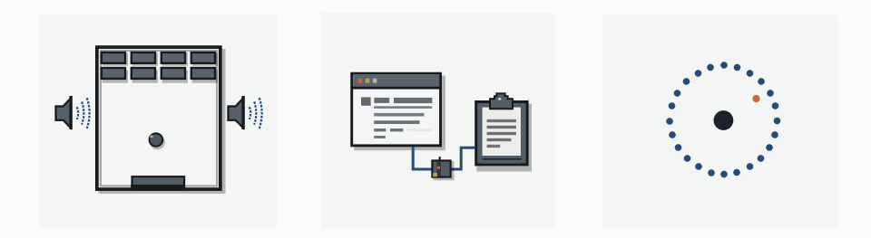
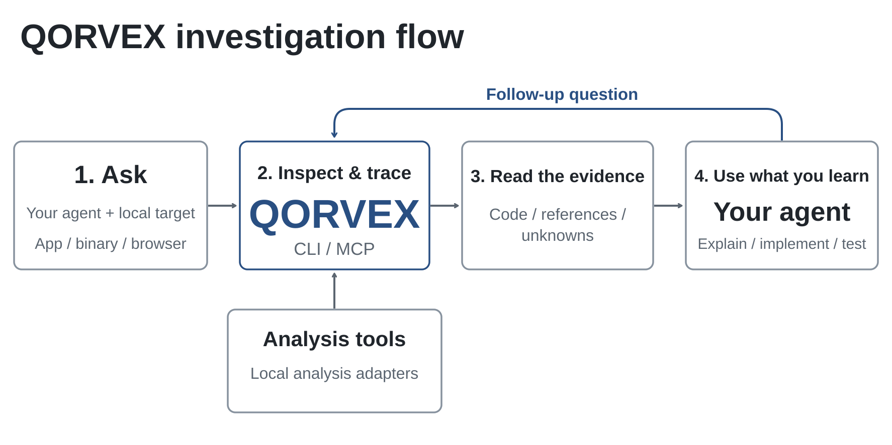

<div align="center">

[English](../../README.md) · [简体中文](README_zh.md) · [繁體中文](README_zh-TW.md) · [日本語](README_ja.md) · [한국어](README_ko.md) · [Türkçe](README_tr.md) · [Русский](README_ru.md) · [Tiếng Việt](README_vi.md) · [ไทย](README_th.md) · [Deutsch](README_de.md) · [Español](README_es.md) · [Français](README_fr.md) · [Українська](README_uk.md) · [Polski](README_pl.md) · [Português (Brasil)](README_pt-BR.md) · [العربية](README_ar.md) · [فارسی](README_fa.md) · [Bahasa Indonesia](README_id.md) · [Italiano](README_it.md)
· [Ελληνικά](README_el.md) · [മലയാളം](README_ml.md) · [Roman Urdu](README_ur-Latn.md) · [Română](README_ro.md) · **Български**

# QORVEX: Reverse Engineer Anything

### Един MCP сървър за обратно инженерство на бинарни файлове, приложения и поведение по време на изпълнение.

**Харесва ви функция в някое приложение? Разберете как работи, чак до ниво бинарен код.**

[](https://github.com/TOSTES-LAB/andre_009988/stargazers)
[](https://www.npmjs.com/package/qorvex-agents)
[](../../LICENSE)
[](https://discord.gg/GkcryMnJDM)
[](https://x.com/reatools)
[](../getting-started/installation.md)
[](https://skills.sh/TOSTES-LAB/andre_009988/reverse-engineer-anything)

**[Уебсайт](https://qorvex.tools/) · [Ръководства](https://qorvex.tools/guides/) · [Примери](https://qorvex.tools/showcase/)**

<a href="https://discord.com/invite/GkcryMnJDM"></a>

[Бърз старт](#бърз-старт) · [Примери](#примери) · [Как работи QORVEX](#как-работи-qorvex) · [Какво можете да анализирате](#какво-можете-да-анализирате) · [Създаване на RL среди](#build-rl-environments) · [Често задавани въпроси](#често-задавани-въпроси) · [Документация](#документация)

<code>npx qorvex-agents setup</code>

</div>

> [!IMPORTANT]
> Изтегляйте QORVEX от [TOSTES-LAB/andre_009988](https://github.com/TOSTES-LAB/andre_009988),
> [qorvex.tools](https://qorvex.tools/) или [npm пакета qorvex-agents](https://www.npmjs.com/package/qorvex-agents).
> Следвайте връзките за инсталиране и издания от тези официални източници. Подобно
> име на хранилище или копиран README не доказва, че дадено изтегляне е официално.

<div align="center">

<br />


<br /><br />

<table aria-label="Общността на QORVEX">
<tr>
<td align="center" width="360">
  <a href="https://discord.gg/GkcryMnJDM">
    <br />
    <strong>Присъединете се към общността за обратно инженерство</strong>
  </a><br />
  <sub>Discord · Въпроси и отговори · Покажете какво сте направили</sub>
</td>
</tr>
</table>

<br />

</div>

---

Видели сте функция в приложение и искате същата във вашия продукт? Помолете агента си да я проучи с QORVEX. Той може да изследва приложението без изходния му код, да обясни как работи функцията, да покаже доказателствата и да изгради подобна версия за вашия проект.

QORVEX свързва агента ви с инструменти за изследване на нативни бинарни файлове, JavaScript и Electron приложения, .NET асемблита и уебсайтове. Същите инструменти можете да използвате и от терминала. Анализът се извършва локално, а резултатите включват доказателствата и ограниченията зад всеки извод.

Настройката регистрира QORVEX в агента ви и инсталира съответните инструкции за работния процес. Нативният анализ може да използва вече инсталиран Hopper, Ghidra, IDA или Kuna; по желание настройката може да инсталира Hopper след ваше одобрение. Статичният анализ на JavaScript не изисква двигател за нативен анализ.

## Бърз старт

**[Бърз старт · qorvex.tools](https://qorvex.tools/bg/get-started/)**

### Настройте агента си (MCP)

След като инсталирате [Node.js и npm](../reference/supported-targets.md), изпълнете командата в доверена директория извън проекта за анализ.

```bash
npx qorvex-agents setup
```

Изберете агентите си, прегледайте предложените промени и ги одобрете. Настройката
добавя MCP сървъра на QORVEX и съответните инструкции за работния процес, като прави
резервни копия на съществуващата конфигурация. След това рестартирайте агента.
Настройката записва директно избраната среда за изпълнение и входния скрипт на
QORVEX. Ако сте получили QORVEX чрез инструмент за изпълнение на пакети (package
runner), не изтривайте записа му в кеша. Изтегляйте пакета от доверена
директория извън целевия проект. Подробности за инсталирането и отстраняването на
проблеми има в ръководството за настройка по-долу.

[инсталиране и настройка](../getting-started/installation.md)

Попитайте агента си:

```text
Разбери как работи търсенето в приложението Notes, покажи ми доказателствата и
изгради подобна функция за моя проект.
```

Заменете Notes с целевото си приложение и функцията, която искате да разберете.

### Използвайте терминала (CLI)

Изследвайте директорията на разархивирано JavaScript/Electron приложение или ASAR
архив:

```bash
npx -y qorvex-agents@latest analyze-javascript-application /absolute/path/to/app --json
```

Резултатът включва модули, импорти, границите на Electron и доказателствата за
тях. Заменете пътя с вашата цел, например `"D:/apps/example"` в Windows.

За да инсталирате командата `qorvex` за редовна употреба:

```bash
npm install --global qorvex-agents
qorvex --help
```

За нативен анализ първо конфигурирайте доставчик на анализ. Вижте
[ръководството за CLI и Evidence](../getting-started/cli.md) за нативните
команди, избора на доставчик, моментните снимки (snapshots) и скриптирането.

[Изисквания за Linux](../getting-started/installation.md#linux-owned-process-prerequisite)

### Обновяване на QORVEX

За CLI, инсталиран с `npm install --global` или `bun add --global`:

```bash
qorvex update
```

Ако използвате `npx`, обновете настройката на агента си с:

```bash
npx qorvex-agents@latest setup
```

[Обновяване и деинсталиране](../getting-started/installation.md#diagnose-update-and-remove)

## Примери

<a href="https://qorvex.tools/showcase/">
  <picture>
    <source media="(prefers-color-scheme: dark)" srcset="../assets/qorvex-showcases-dark.svg" />
    
  </picture>
</a>

<table>
<tbody>
<tr><td>
<h3>DX-Ball: реконструиране на изчислението на звуковата панорама</h3>
<p>Проследете извикване на звук до помощната функция, която превръща позицията в
панорама, изследвайте инструкциите и превърнете непълния псевдокод в C.
Реконструкцията минава 3 205 тестови случая спрямо оригиналния x86 код и
възпроизвежда всичките 63 байта на компилираната функция.</p>
<p><a href="https://qorvex.tools/showcase/dx-ball/">Прочетете казуса</a> ·
<a href="https://github.com/N0zoM1z0/dx-ball">Хранилище с реконструкцията</a></p>
</td></tr>
<tr><td>
<h3>Notion: проследяване на моста за клипборда в Electron</h3>
<p>Открийте API-то за клипборда в renderer процеса, проследете го през preload
скрипта и IPC до главния процес и изследвайте формата за форматирано съдържание
в клипборда.</p>
<p><a href="https://qorvex.tools/showcase/notion/">Прочетете казуса</a></p>
</td></tr>
<tr><td>
<h3>TH04: възстановяване на изчислението на пръстена от куршуми в DOS</h3>
<p>Изследвайте 16-битовите инструкции на оригиналната игра за PC-98, възстановете
изчисленията на фиксираните и насочените ъгли и сравнете реконструирания C++ код
с изхода на историческия компилатор.</p>
<p><a href="https://qorvex.tools/showcase/th04/">Прочетете казуса</a> ·
<a href="https://github.com/N0zoM1z0/th04">Хранилище с реконструкцията</a></p>
</td></tr>
</tbody>
</table>

Ако сте използвали QORVEX за нещо интересно, ще се радваме да го видим. Споделете
случая си в [issue](https://github.com/TOSTES-LAB/andre_009988/issues) или
[pull request](https://github.com/TOSTES-LAB/andre_009988/pulls), като включите целта,
въпроса си, как ви помогна QORVEX и какво открихте.

## Как работи QORVEX

Агентът ви извиква QORVEX чрез MCP, за да изследва целта и да проследи съответния
код. QORVEX връща констатации заедно с доказателствата за тях. Агентът ги използва,
за да задава допълнителни въпроси, да обяснява поведението или да напише и тества
реализация. CLI командите използват същите работни процеси.



[Отворете фигурата в пълен размер](../../website/public/assets/figures/qorvex-investigation-flow.svg).

<a id="current-status"></a>

## Какво можете да анализирате

Нативни бинарни файлове · JavaScript / Electron · Уебсайтове · .NET асемблита · Android APK файлове · Фърмуер · Поведение на процеси

[Поддържани формати и изисквания](../reference/supported-targets.md)

<a id="choosing-a-deep-analysis-provider"></a>

[Избор на доставчик за анализ](../reference/supported-targets.md#choosing-a-deep-analysis-provider)

<a id="build-rl-environments"></a>

## Създаване на RL среди

Създайте локална среда от записана уеб сесия или настолно приложение за Linux, за да може агентът да упражнява задача и да проверява резултата.

[Създаване на RL среди](https://qorvex.tools/guides/rl-environments/)

## Често задавани въпроси

<details>
<summary><strong>Кои агенти могат да използват QORVEX?</strong></summary>

Всеки агент, който поддържа локални MCP сървъри. Настройката конфигурира
[поддържаните агенти](../getting-started/installation.md#supported-agents);
другите клиенти могат да използват
[ръчна MCP регистрация](../getting-started/installation.md#mcp-registry).

</details>

<details>
<summary><strong>Нужен ли ми е двигател за нативен анализ?</strong></summary>

Задълбоченият нативен анализ използва Hopper, Ghidra, IDA или Kuna в зависимост
от целта и операцията. Статичната проверка на JavaScript и .NET работи без
двигател за нативен анализ. Настройката може да инсталира Hopper след ваше
одобрение; Ghidra, IDA и Kuna се използват от вече съществуващите ви инсталации.
Вижте [настройката на доставчиците](../getting-started/installation.md#hopper)
за възможностите и поддържаните от тях цели.

</details>

<details>
<summary><strong>Трябва ли първо да стартирам Hopper?</strong></summary>

QORVEX стартира Hopper, когато дадена операция се нуждае от него. В macOS при първо
стартиране може да се появи диалогов прозорец, който ви пита дали да изберете
демо режим, или да активирате лиценза си. Завършете този диалог в същата
потребителска сесия преди първата си CLI/MCP операция или задача, която ще се
изпълнява без надзор. При нужда отворете Hopper ръчно. Вижте
[стартиране и отстраняване на проблеми с Hopper](../getting-started/installation.md#launcher-paths-and-troubleshooting).

</details>

<details>
<summary><strong>Какво прави инсталирането на умението (skill) от skills.sh?</strong></summary>

Умението дава на агента ви инструкции как да провежда изследвания. Използвайте
`npx qorvex-agents setup`, за да регистрирате MCP сървъра на QORVEX и да инсталирате
съответните инструкции, след което рестартирайте агента. Вижте
[инсталиране само на умението](../getting-started/installation.md#skill-only-installation).

</details>

<details>
<summary><strong>Какъв код връща QORVEX?</strong></summary>

Нативният анализ връща псевдокод и асемблер. Анализът на JavaScript/Electron
възстановява модулите и връзките между тях. Агентът ви използва тези
констатации, за да напише и тества реализация; [примерите](#примери) показват
цялостни разработени случаи.

</details>

<details>
<summary><strong>Качва ли QORVEX приложението ми някъде?</strong></summary>

QORVEX анализира целите локално. Агентът ви получава резултатите от инструментите,
а доставчикът на модела, който агентът използва, има собствена политика за
данните.

</details>

<details>
<summary><strong>Какво да направя, ако попадна на грешка?</strong></summary>

Първо обновете; възможно е скорошно издание вече да я е поправило.

За CLI, инсталиран с `npm install --global` или `bun add --global`:

```bash
qorvex update
```

За настройка на агента чрез `npx`:

```bash
npx qorvex-agents@latest setup
```

Ако използвате агент, извършете
[опресняването на настройката](#обновяване-на-qorvex) и го рестартирайте. Опитайте
отново същата задача. Ако проблемът продължава,
[отворете issue](https://github.com/TOSTES-LAB/andre_009988/issues), като посочите версията
на QORVEX, типа на целта, стъпките за възпроизвеждане и изхода с грешката.

</details>

## Документация

Започнете с [практическите ръководства](https://qorvex.tools/guides/) на уебсайта.
За точните опции, предварителните изисквания и договорите за резултатите:

- [Инсталиране и настройка](../getting-started/installation.md): регистриране на агенти, конфигуриране на доставчици, обновяване и деинсталиране.
- [Готовност и отстраняване на проблеми](../getting-started/installation.md#check-readiness-for-your-task): диагностика на конкретен агент или двигател за анализ.
- [CLI и Evidence](../getting-started/cli.md): команди, избор на доставчик, моментни снимки, импорт/експорт и изходни статуси.
- [MCP договори](../reference/mcp-contracts.md) и [подсказки за агенти](../getting-started/mcp-prompts.md): резултати от инструментите, сесии и насочвани изследвания.
- [Каталог с инструменти](../reference/mcp-contracts.md#generated-catalog): генериран списък с инструменти, доставчици и CLI команди.

Съобщавайте за уязвимости чрез [SECURITY.md](../../SECURITY.md).

## Общност и поддръжка

- **Discord** — Задавайте въпроси и споделяйте проучванията си с над 50 000 души, които се увличат по обратното инженерство и създават свои проекти! [](https://discord.gg/GkcryMnJDM)
- **Twitter / X** — Следете [@reatools](https://x.com/reatools) за новини.
- **Отзиви и идеи** — Искате нова функция или поддръжка на файлов формат? Пишете ни в [GitHub](https://github.com/TOSTES-LAB/andre_009988/issues) или [Discord](https://discord.gg/GkcryMnJDM).

## История на звездите

🎉 **400 000 звезди в GitHub — благодарим ви!**

Благодарим на всички, които използват QORVEX, съобщават за грешки, предлагат нови функции, тестват версии и допринасят с поправки.

<a href="https://qorvex.tools/bg/contributors/">
  
</a>

<a href="https://www.star-history.com/?repos=TOSTES-LAB%2Frea&amp;type=date">
  <picture>
    <source media="(prefers-color-scheme: dark)" srcset="https://api.star-history.com/chart?repos=TOSTES-LAB/andre_009988&amp;type=date&amp;theme=dark&amp;legend=top-left" />
    <source media="(prefers-color-scheme: light)" srcset="https://api.star-history.com/chart?repos=TOSTES-LAB/andre_009988&amp;type=date" />
    
  </picture>
</a>

## Принос към проекта

Ще се радваме на помощта ви с QORVEX! [Отворете issue](https://github.com/TOSTES-LAB/andre_009988/issues),
за да съобщите за грешка или да предложите функция, или
[изпратете pull request](https://github.com/TOSTES-LAB/andre_009988/pulls), за да подобрите
кода или документацията.

Вижте [CONTRIBUTING.md](../../CONTRIBUTING.md) за настройка на средата за
разработка и проверките, [тестване](../development/testing.md) за видовете
проверки.

## Отказ от отговорност

Вижте [DISCLAIMER.md](../../DISCLAIMER.md) за насоки за отговорна употреба.

Позицията на проекта относно незаконната или неразрешената употреба обхваща
всички версии, канали за разпространение и платформи на QORVEX; всяко копие запазва
приложимите за него лицензи.

QORVEX е предназначен за законни изследвания, обучение, оперативна съвместимост,
съхраняване на софтуер и анализ на софтуер, който притежавате или имате
разрешение да изследвате.

## Лиценз

[MIT](../../LICENSE)

Кодът, написан за проекта QORVEX, е лицензиран под MIT. Материалите от трети страни
запазват собствените си лицензи и бележки за авторски права; вижте
[бележките за трети страни](../../THIRD_PARTY_NOTICES.md) за списъка със
зависимости, запазените текстове на лицензите и условията на външните
инструменти.

**Трябва да сте придобили законно търговските инструменти и да имате право да ги
използвате**, включително IDA Pro / декомпилаторите на Hex-Rays, Hopper и JEB,
съгласно приложимите им лицензи. QORVEX не предоставя лиценз, ключ или право на
активиране за нито един инструмент. Пробните и демо версиите остават обект на
условията на производителя, включително ограниченията за брой потребители,
функции, автоматизация и споделяне на резултатите. Кракнати копия, откраднати
ключове, неразрешено споделяне на ключове и заобикаляне на лицензионни
ограничения не са разрешени. Тези насоки не изменят лиценза MIT или лицензите на
трети страни.
