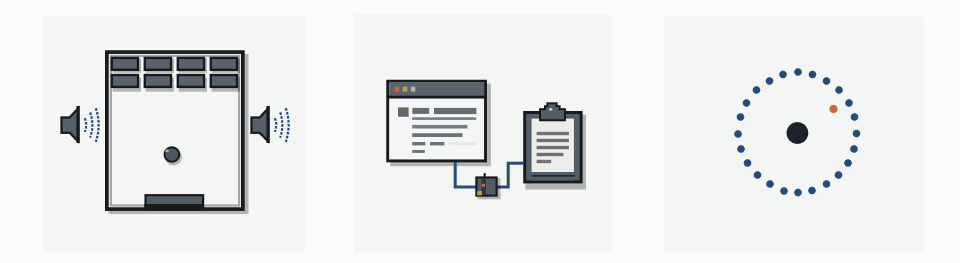
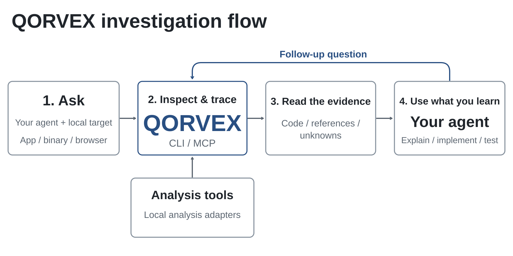

<div align="center">

[English](../../README.md) · [简体中文](README_zh.md) · [繁體中文](README_zh-TW.md) · [日本語](README_ja.md) · [한국어](README_ko.md) · [Türkçe](README_tr.md) · [Русский](README_ru.md) · [Tiếng Việt](README_vi.md) · [ไทย](README_th.md) · [Deutsch](README_de.md) · [Español](README_es.md) · [Français](README_fr.md) · [Українська](README_uk.md) · [Polski](README_pl.md) · **Português (Brasil)** · [العربية](README_ar.md) · [فارسی](README_fa.md) · [Bahasa Indonesia](README_id.md) · [Italiano](README_it.md)
· [Ελληνικά](README_el.md) · [മലയാളം](README_ml.md) · [Roman Urdu](README_ur-Latn.md) · [Română](README_ro.md) · [Български](README_bg.md)

# QORVEX: Faça engenharia reversa de qualquer coisa

### Um único MCP para engenharia reversa de binários, aplicativos e comportamento em execução.

**Viu uma funcionalidade de que gostou? Entenda como ela funciona, até o nível binário.**

[](https://github.com/TOSTES-LAB/andre_009988/stargazers)
[](https://www.npmjs.com/package/qorvex-agents)
[](../../LICENSE)
[](https://discord.gg/GkcryMnJDM)
[](https://x.com/reatools)
[](../getting-started/installation.md)
[](https://skills.sh/TOSTES-LAB/andre_009988/reverse-engineer-anything)

**[Site](https://qorvex.tools/pt-BR/) · [Guias](https://qorvex.tools/pt-BR/guides/) · [Casos de uso](https://qorvex.tools/pt-BR/showcase/)**

<a href="https://discord.com/invite/GkcryMnJDM"></a>

[Início rápido](#início-rápido) · [Casos de uso](#casos-de-uso) · [Como o QORVEX funciona](#como-o-qorvex-funciona) · [O que você pode analisar](#o-que-você-pode-analisar) · [Criar ambientes de RL](#build-rl-environments) · [Perguntas frequentes](#perguntas-frequentes) · [Documentação](#documentação)

<code>npx qorvex-agents setup</code>

</div>

> [!IMPORTANT]
> Fontes oficiais do QORVEX: [TOSTES-LAB/andre_009988](https://github.com/TOSTES-LAB/andre_009988), [qorvex.tools](https://qorvex.tools/), [qorvex-agents](https://www.npmjs.com/package/qorvex-agents) (npm).
> Use os links de instalação e de versões dessas fontes oficiais. Um nome de repositório parecido ou um README copiado não comprova que um download seja oficial.

<div align="center">

<br />


<br /><br />

<table aria-label="Comunidade QORVEX">
<tr>
<td align="center" width="360">
  <a href="https://discord.gg/GkcryMnJDM">
    <br />
    <strong>Participe da comunidade de engenharia reversa</strong>
  </a><br />
  <sub>Discord · Perguntas e respostas · Compartilhe seus resultados</sub>
</td>
</tr>
</table>

<br />

</div>

---

Viu uma funcionalidade em um aplicativo que gostaria de ter no seu próprio produto? Peça ao seu agente para investigá-la com o QORVEX. Ele pode inspecionar o aplicativo sem o código-fonte, explicar como a funcionalidade funciona, apresentar as evidências e criar uma versão para o seu projeto.

O QORVEX conecta seu agente a ferramentas para inspecionar binários nativos, aplicativos JavaScript e Electron, assemblies .NET e sites. Você também pode usar as mesmas ferramentas pelo terminal. A análise acontece localmente, e os resultados incluem as evidências e limitações por trás de cada conclusão.

A configuração registra o QORVEX no seu agente e instala as instruções de trabalho correspondentes. A análise nativa pode usar Hopper, Ghidra, IDA ou Kuna já instalados; o Hopper pode ser instalado após sua aprovação. A análise estática de JavaScript não precisa de um mecanismo de análise nativa.

## Início rápido

**[Início rápido · qorvex.tools](https://qorvex.tools/pt-BR/get-started/)**

### Configure seu agente (MCP)

Com [Node.js e npm](../reference/supported-targets.md) instalados, execute este comando em um diretório confiável fora do projeto que você vai analisar.

```bash
npx qorvex-agents setup
```

Escolha seus agentes, revise as alterações propostas e aprove-as. A configuração adiciona o servidor MCP do QORVEX e as instruções de fluxo de trabalho correspondentes, com backups das configurações existentes. Reinicie seu agente depois.

[instalação e configuração](../getting-started/installation.md)

Peça ao seu agente:

```text
Investigue como a busca funciona no aplicativo Notes, mostre as evidências e crie uma funcionalidade semelhante para o meu projeto.
```

Substitua Notes pelo aplicativo alvo e indique a funcionalidade que deseja entender.

### Use o terminal (CLI)

Inspecione um diretório extraído de um aplicativo JavaScript/Electron ou um arquivo ASAR:

```bash
npx -y qorvex-agents@latest analyze-javascript-application /absolute/path/to/app --json
```

O resultado inclui módulos, importações, limites do Electron e suas evidências. Substitua o caminho pelo do seu alvo, como `"D:/apps/example"` no Windows.

Para instalar o comando `qorvex` e usá-lo regularmente:

```bash
npm install --global qorvex-agents
qorvex --help
```

Para análise nativa, configure primeiro um provedor. Consulte o [guia de CLI e Evidence](../getting-started/cli.md) para comandos nativos, seleção de provedores, snapshots e uso em scripts.

[Requisitos para Linux](../getting-started/installation.md#linux-owned-process-prerequisite)

### Atualize o QORVEX

Para uma CLI instalada pelo `npm install --global` / `bun add --global`:

```bash
qorvex update
```

Se você usa `npx`, atualize a configuração do agente com:

```bash
npx qorvex-agents@latest setup
```

[Atualização e desinstalação](../getting-started/installation.md#diagnose-update-and-remove)

## Casos de uso

<a href="https://qorvex.tools/pt-BR/showcase/">
  <picture>
    <source media="(prefers-color-scheme: dark)" srcset="../assets/qorvex-showcases-dark.svg" />
    
  </picture>
</a>

<table>
<tbody>
<tr><td>
<h3>DX-Ball: reconstruir um cálculo de panorâmica de áudio</h3>
<p>Siga uma chamada de áudio até a função auxiliar que converte posição em panorâmica, inspecione as instruções e transforme pseudocódigo incompleto em C. A reconstrução passa em 3.205 casos com o x86 original e reproduz todos os 63 bytes da função compilada.</p>
<p><a href="https://qorvex.tools/pt-BR/showcase/dx-ball/">Leia o estudo de caso</a> · <a href="https://github.com/N0zoM1z0/dx-ball">Repositório da reconstrução</a></p>
</td></tr>
<tr><td>
<h3>Notion: rastrear a ponte da área de transferência do Electron</h3>
<p>Encontre a API da área de transferência do renderizador, siga-a por preload e IPC até o processo principal e inspecione o formato da área de transferência com seus dados de formatação.</p>
<p><a href="https://qorvex.tools/pt-BR/showcase/notion/">Leia o estudo de caso</a></p>
</td></tr>
<tr><td>
<h3>TH04: recuperar o cálculo de um anel de projéteis no DOS</h3>
<p>Inspecione as instruções de 16 bits do jogo original para PC-98, recupere os cálculos de ângulos fixos e direcionados e compare o C++ reconstruído com a saída do compilador da época.</p>
<p><a href="https://qorvex.tools/pt-BR/showcase/th04/">Leia o estudo de caso</a> · <a href="https://github.com/N0zoM1z0/th04">Repositório da reconstrução</a></p>
</td></tr>
</tbody>
</table>

Se você usou o QORVEX em algo interessante, gostaríamos de conhecer. Compartilhe seu caso em uma [issue](https://github.com/TOSTES-LAB/andre_009988/issues) ou um [pull request](https://github.com/TOSTES-LAB/andre_009988/pulls), incluindo o alvo, sua pergunta, como o QORVEX ajudou e o que descobriu.

## Como o QORVEX funciona

Seu agente chama o QORVEX por MCP para inspecionar o alvo e rastrear o código relevante. O QORVEX retorna os resultados com suas evidências. O agente usa esses resultados para fazer novas perguntas, explicar o comportamento ou escrever e testar uma implementação. Os comandos da CLI usam os mesmos fluxos de trabalho.



[Abra a figura em tamanho completo](../../website/public/assets/figures/qorvex-investigation-flow.svg).

<a id="current-status"></a>

## O que você pode analisar

Binários nativos · JavaScript / Electron · Sites · Assemblies .NET · APKs Android · Firmware · Comportamento de processos

[Formatos aceitos e requisitos](../reference/supported-targets.md)

<a id="choosing-a-deep-analysis-provider"></a>

[Escolha do provedor de análise](../reference/supported-targets.md#choosing-a-deep-analysis-provider)

<a id="build-rl-environments"></a>

## Criar ambientes de RL

Crie um ambiente local a partir de uma sessão web gravada ou de um aplicativo de desktop Linux para um agente praticar uma tarefa e verificar o resultado.

[Criar ambientes de RL](https://qorvex.tools/guides/rl-environments/)

## Perguntas frequentes

<details>
<summary><strong>Quais agentes podem usar o QORVEX?</strong></summary>

Qualquer agente que ofereça suporte a servidores MCP locais. A configuração prepara os [agentes compatíveis](../getting-started/installation.md#supported-agents); outros clientes podem usar o [registro manual do MCP](../getting-started/installation.md#mcp-registry).

</details>

<details>
<summary><strong>Preciso do Hopper, Ghidra, IDA ou Kuna?</strong></summary>

A análise nativa aprofundada usa um desses motores. A inspeção estática de JavaScript e .NET funciona sem um motor de análise nativa. A configuração pode instalar o Hopper após aprovação; Ghidra, IDA e Kuna usam as instalações existentes. Consulte [configuração dos provedores](../getting-started/installation.md#hopper).

</details>

<details>
<summary><strong>Preciso iniciar o Hopper antes?</strong></summary>

O QORVEX inicia o Hopper quando uma operação precisa dele. No macOS, um diálogo na primeira execução pode pedir que você escolha o modo de demonstração ou ative a licença. Consulte [inicialização do Hopper e solução de problemas](../getting-started/installation.md#launcher-paths-and-troubleshooting).

</details>

<details>
<summary><strong>O que faz a instalação da skill pelo skills.sh?</strong></summary>

A skill fornece instruções de investigação ao seu agente. Use `npx qorvex-agents setup` para registrar o servidor MCP do QORVEX e instalar as instruções correspondentes, depois reinicie seu agente. Consulte [instalação apenas da skill](../getting-started/installation.md#skill-only-installation).

</details>

<details>
<summary><strong>Que código o QORVEX retorna?</strong></summary>

A análise nativa retorna pseudocódigo e assembly. A análise de JavaScript/Electron recupera módulos e suas relações. Seu agente usa esses resultados para escrever e testar uma implementação; os [casos de uso](#casos-de-uso) apresentam exemplos completos.

</details>

<details>
<summary><strong>O QORVEX envia meu aplicativo para algum servidor?</strong></summary>

O QORVEX analisa os alvos localmente. Seu agente recebe os resultados das ferramentas, e o provedor do modelo tem sua própria política de dados.

</details>

<details>
<summary><strong>O que devo fazer se encontrar um bug?</strong></summary>

Atualize primeiro; uma versão recente pode já ter corrigido o problema.

Para uma CLI instalada pelo npm:

```bash
qorvex update
```

Para configurar o agente por `npx`:

```bash
npx qorvex-agents@latest setup
```

Se você usa um agente, conclua a [atualização da configuração](#atualize-o-qorvex) e reinicie-o. Tente executar a mesma tarefa novamente. Se o problema persistir, [abra uma issue](https://github.com/TOSTES-LAB/andre_009988/issues) com sua versão do QORVEX, o tipo de alvo, os passos para reproduzir e a saída do erro.

</details>

## Documentação

Comece pelos [guias práticos](https://qorvex.tools/pt-BR/guides/) do site. Para opções exatas, pré-requisitos e contratos dos resultados:

- [Instalação e configuração](../getting-started/installation.md): registro de agentes, configuração de provedores, atualizações e desinstalação.
- [Prontidão e solução de problemas](../getting-started/installation.md#check-readiness-for-your-task): diagnóstico de um agente ou motor de análise específico.
- [CLI e Evidence](../getting-started/cli.md): comandos, seleção de provedores, snapshots, importação/exportação e status de saída.
- [Contratos MCP](../reference/mcp-contracts.md) e [prompts para agentes](../getting-started/mcp-prompts.md): resultados das ferramentas, sessões e investigações guiadas.
- [Catálogo de ferramentas](../reference/mcp-contracts.md#generated-catalog): inventário de ferramentas, provedores e comandos da CLI gerado durante o build.

Relate vulnerabilidades conforme [SECURITY.md](../../SECURITY.md).

## Comunidade e suporte

- **Discord** — Tire dúvidas e compartilhe suas investigações com nossa comunidade de mais de 50 mil pessoas apaixonadas por engenharia reversa e pela criação de projetos! [](https://discord.gg/GkcryMnJDM)
- **Twitter / X** — Siga [@reatools](https://x.com/reatools) para acompanhar as novidades.
- **Sugestões e ideias** — Quer um recurso ou suporte a um formato de arquivo? Fale conosco pelo [GitHub](https://github.com/TOSTES-LAB/andre_009988/issues) ou [Discord](https://discord.gg/GkcryMnJDM).

## Histórico de estrelas

🎉 **400.000 estrelas no GitHub — muito obrigado!**

Obrigado a todos que usam o QORVEX, relatam bugs, sugerem funcionalidades, testam builds e contribuem com correções.

<a href="https://qorvex.tools/pt-BR/contributors/">
  
</a>

<a href="https://www.star-history.com/?repos=TOSTES-LAB%2Frea&amp;type=date">
  <picture>
    <source media="(prefers-color-scheme: dark)" srcset="https://api.star-history.com/chart?repos=TOSTES-LAB/andre_009988&amp;type=date&amp;theme=dark&amp;legend=top-left" />
    <source media="(prefers-color-scheme: light)" srcset="https://api.star-history.com/chart?repos=TOSTES-LAB/andre_009988&amp;type=date" />
    
  </picture>
</a>

## Contribuir

Sua ajuda com o QORVEX é bem-vinda! [Abra uma issue](https://github.com/TOSTES-LAB/andre_009988/issues) para relatar um bug ou sugerir uma funcionalidade, ou [envie um pull request](https://github.com/TOSTES-LAB/andre_009988/pulls) para melhorar o código ou a documentação.

Consulte [CONTRIBUTING.md](../../CONTRIBUTING.md) para configurar o ambiente de desenvolvimento e as verificações, o [guia de testes](../development/testing.md) para os fluxos de verificação.

## Aviso legal

Consulte [DISCLAIMER.md](../../DISCLAIMER.md) para orientações sobre o uso responsável.

O QORVEX destina-se à pesquisa, à educação, à interoperabilidade, à preservação de software e à análise de software que você possui ou está autorizado a examinar, dentro da lei.

The project's position on illegal or unauthorized use covers all QORVEX
versions, distribution channels, and platforms; each copy retains its
applicable licenses.

## Licença

[MIT](../../LICENSE)

QORVEX-authored code is licensed under MIT. Third-party material retains its own
licenses and copyright notices; see [Third-party notices](../../THIRD_PARTY_NOTICES.md)
for the dependency inventory, preserved license texts, and external-tool terms.

**You must legally obtain and be authorized to use commercial tools**, including
IDA Pro / Hex-Rays decompilers, Hopper, and JEB, under their applicable licenses.
QORVEX grants no tool license, key, or activation entitlement. Trials and demos
remain subject to vendor terms, including user, feature, automation, and output
sharing restrictions. Cracked copies, stolen keys, unauthorized key sharing,
and bypassing license restrictions are not authorized. This guidance does not
amend MIT or third-party licenses.
